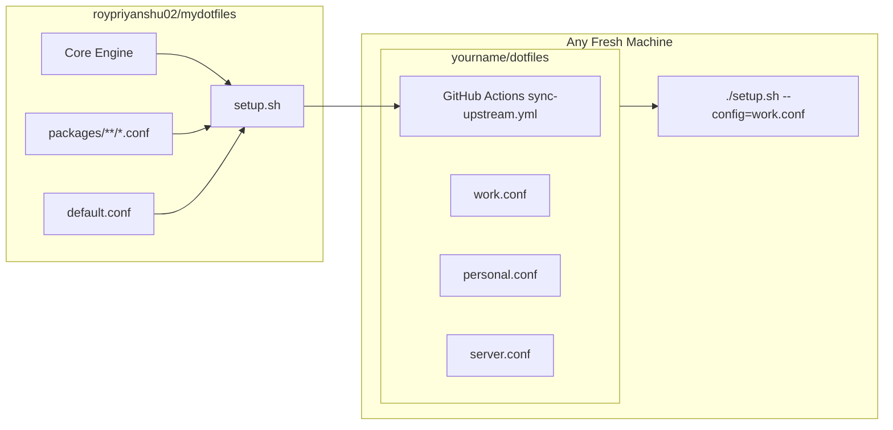

# User Guide

This guide walks through creating your personal dotfiles repository, managing machine environments, automating updates from upstream, and provisioning new systems.

---

## 1. Overview & Architecture

`mydotfiles` separates your personal environment settings from cross-distro package definitions:

- **Upstream Engine & Package Manifests**: Maintained in `mydotfiles` with multi-distro definitions (`apt`, `dnf`, `pacman`, `brew`, `cargo`), pre/post hooks, and default configuration templates.
- **Your Personal Repository**: Contains only `setup.sh` (the self-extracting distribution bundle) and your personal configuration files (`*.conf`).



---

## 2. Creating Your Personal Dotfiles Repo

### Step 1: Initialize Your Git Repository

Create a new repository on GitHub or GitLab (e.g. `yourname/dotfiles`).

```bash
mkdir my-dotfiles && cd my-dotfiles
git init
```

### Step 2: Download `setup.sh`

Download the latest compiled bundle from upstream:

```bash
curl -fsSL https://raw.githubusercontent.com/roypriyanshu02/mydotfiles/main/setup.sh -o setup.sh
chmod +x setup.sh
```

### Step 3: Create Your Configuration File (`custom.conf`)

Create a configuration file (e.g. `custom.conf`, `work.conf`, or `personal.conf`):

```ini
# custom.conf: Personal machine environment

[config]
# Select package groups to install (from packages/_groups.conf)
# Available: core, package-managers, shell, runtimes, sys-info, security-and-net, dev-tools, utilities, ai-agents
INSTALL_GROUPS = core, shell, dev-tools, runtimes

# Condition overrides (force enable or disable specific features)
# COND = wsl
# DISABLE_COND = container

# ── Git Identity & Package Overrides ──────────────────────────────────────────
[package:gitconfig]
GIT_USER_NAME = Your Name
GIT_EMAIL = you@example.com

# ── Custom Shell Environment & Aliases ────────────────────────────────────────
[bashrc:append]
export EDITOR="nvim"
export PROJECTS_DIR="$HOME/Pro"
alias g="git"
alias ll="eza -la"

# Suppress fzf shell integration if unneeded
# [bashrc:fzf:disable]

# ── Dotfile Template Overrides ────────────────────────────────────────────────
# Discard upstream template and provide your complete config
[template:.gitconfig:override]
[user]
    name = Your Name
    email = you@example.com
[core]
    editor = nvim
[init]
    defaultBranch = main

# Suppress deployment of specific templates
# [template:starship.toml:disable]
```

> For full syntax details, condition tags (`wsl`, `container`), and section modifiers (`:append`, `:override`, `:disable`), see the **[Configuration & Manifest Syntax Reference](MANIFEST_SYNTAX.md)**.

### Step 4: Validate Your Configuration

Run the built-in formatter and linter before committing:

```bash
./setup.sh --fmt
./setup.sh --lint
```

### Step 5: Commit & Push

```bash
git add setup.sh custom.conf
git commit -m "feat: init personal dotfiles repository"
git remote add origin https://github.com/yourname/dotfiles.git
git push -u origin main
```

---

## 3. Automating Upstream Updates via GitHub Actions

To keep your `setup.sh` bundle up-to-date with upstream bug fixes, package additions, and distro adjustments without manual downloading:

Create `.github/workflows/sync-upstream.yml` in your personal repo:

```yaml
name: Sync Upstream setup.sh

on:
  schedule:
    - cron: '0 0 * * 1' # Runs every Monday at midnight
  workflow_dispatch:      # Allows manual trigger via GitHub UI

jobs:
  sync:
    runs-on: ubuntu-latest
    permissions:
      contents: write
    steps:
      - uses: actions/checkout@v4

      - name: Download latest standalone bundle
        run: |
          curl -fsSL https://raw.githubusercontent.com/roypriyanshu02/mydotfiles/main/setup.sh -o setup.sh
          chmod +x setup.sh

      - name: Validate configuration files against new bundle
        run: |
          ./setup.sh --lint

      - name: Commit and push changes
        uses: stefanzweifel/git-auto-commit-action@v5
        with:
          commit_message: "chore: sync setup.sh with upstream"
          file_pattern: "setup.sh"
```

---

## 4. Provisioning a New Machine

On any fresh Linux system, WSL instance, VPS, or container:

```bash
git clone https://github.com/yourname/dotfiles.git ~/.dotfiles-repo
cd ~/.dotfiles-repo

# Interactive mode (TUI menu for selective installation)
./setup.sh --config=custom.conf

# Headless mode (fully automated setup for CI/CD, containers, or remote servers)
./setup.sh --config=custom.conf --non-interactive
```

---

## 5. Maintenance & Disaster Recovery

### Environment Diagnostics & Fixes

Audit PATH variables, broken symlinks, missing compilers, and required dependencies:

```bash
./setup.sh --doctor --fix
```

### Clean Broken Symlinks

Prune orphaned symlinks in `$HOME` pointing to nonexistent targets:

```bash
./setup.sh --clean-symlinks
```

### Rollback Previous State

Every deployment creates a timestamped backup in `~/.dotfiles.bak/` with a SHA-256 manifest:

```bash
# Interactive rollback selector
./setup.sh --rollback

# Roll back to a specific timestamped snapshot
./setup.sh --rollback=20260819_120000
```
